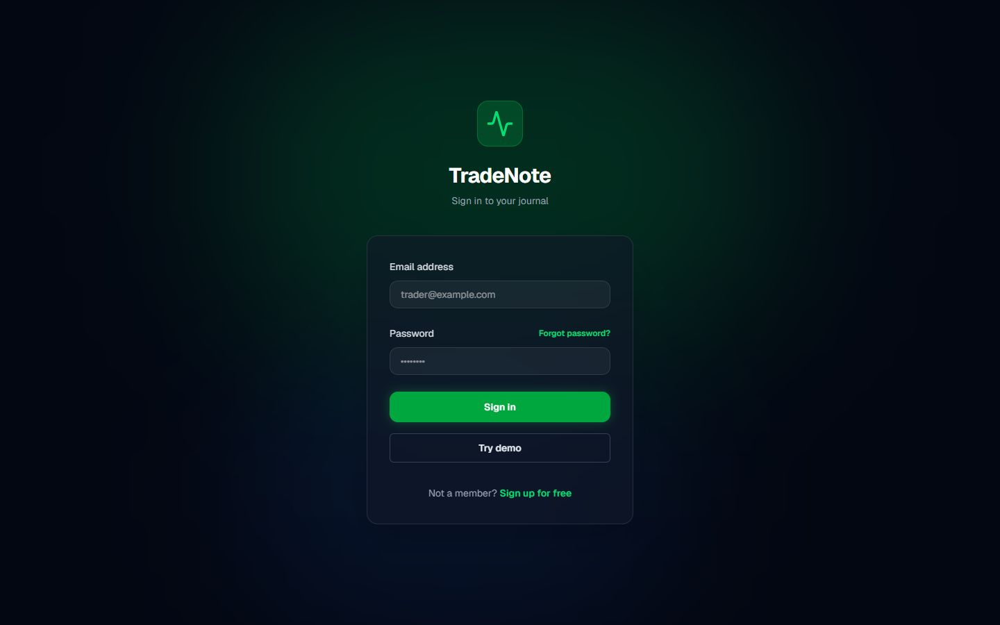
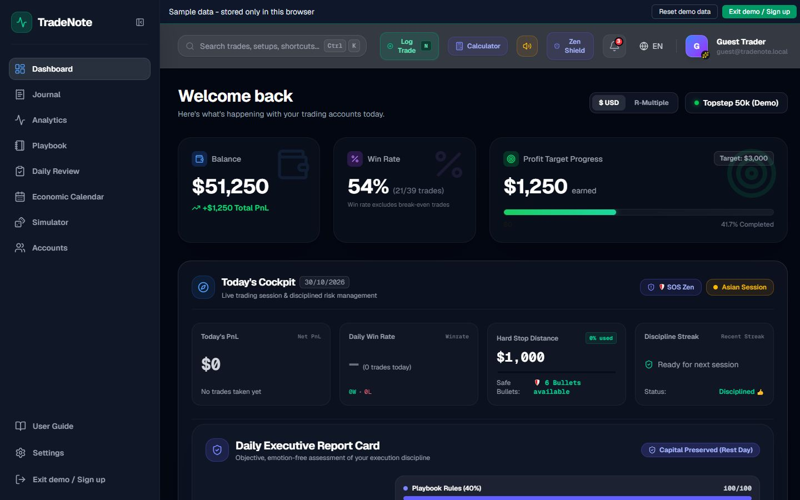
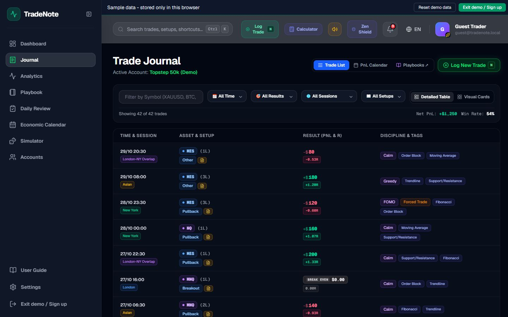
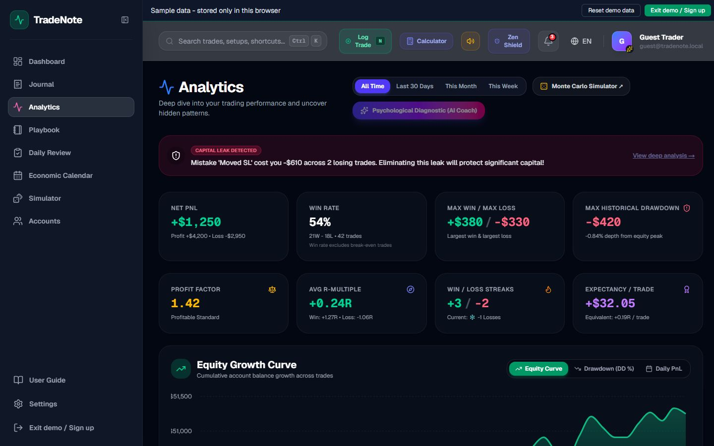
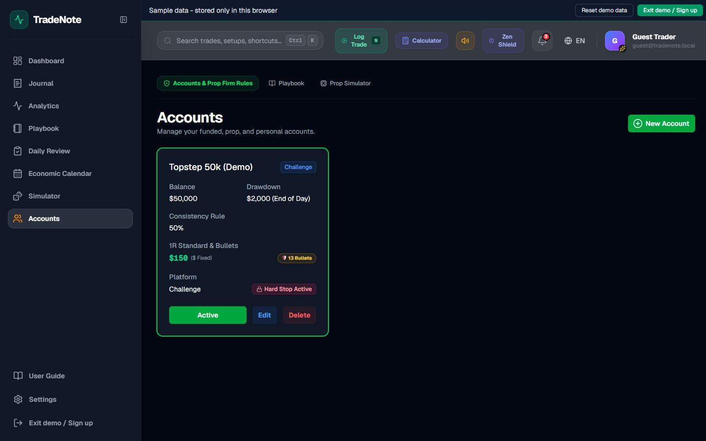
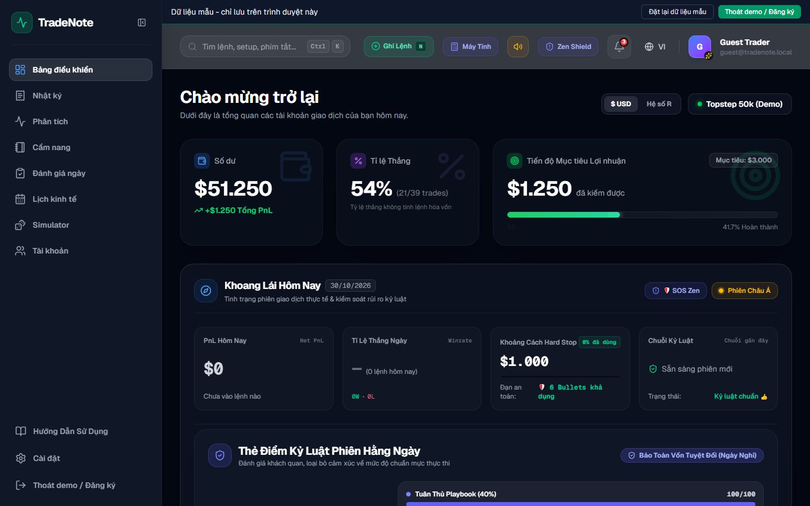
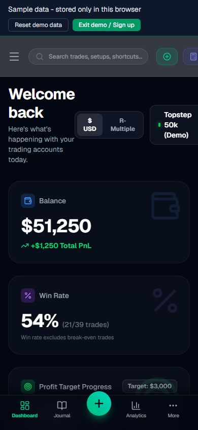

# TradeNote

Tiếng Việt | [English](#english)

## Tiếng Việt

**TradeNote** là nhật ký giao dịch dành cho trader prop firm (Futures, Forex, Crypto), tập trung vào kỷ luật tâm lý: bảo vệ vốn trước drawdown, hạn chế tilt và ghi lệnh thật nhanh. Ứng dụng dùng Next.js 16 (App Router), Supabase (PostgreSQL + Auth + Storage) và có giao diện song ngữ Anh - Việt.

### Ảnh chụp màn hình

Tất cả ảnh chụp ở chế độ Guest demo (dữ liệu mẫu).


*Trang đăng nhập có nút "Try demo" để dùng thử không cần tài khoản.*


*Dashboard: số dư, tỉ lệ thắng, tiến độ mục tiêu lợi nhuận, khoảng cách Hard Stop và số Bullets còn lại.*


*Nhật ký giao dịch: bảng chi tiết, bộ lọc, session, R-multiple, cảm xúc và thẻ kỷ luật.*


*Phân tích: Net PnL, Profit Factor, Expectancy, đường vốn và cảnh báo rò rỉ vốn do sai lầm lặp lại.*


*Tài khoản prop firm: drawdown, quy tắc nhất quán, chuẩn 1R, số Bullets và Hard Stop.*


*Giao diện tiếng Việt (`/vi`).*


*Giao diện di động (390x844).*

### Tính năng

- **Drawdown High Water Mark (HWM)**: trailing drawdown kiểu Intraday và End-of-Day.
- **Live Bullets / 1R**: 1R tính theo % Max Drawdown (tài khoản challenge) hoặc % số dư (tài khoản thường); huy hiệu an toàn theo số Bullets còn lại.
- **Hard Stop (Tilt Guard)**: khoá nhập lệnh khi chạm giới hạn lỗ ngày. Phía client là logic thuần trong `src/lib/hardStop.ts`; phía server là các trigger SQL (`trg_hard_stop` trên `trades`, khoá cấu hình trên `accounts.rules` và `user_preferences`, patch 050-053). Trigger chỉ áp dụng cho JWT của người dùng; SQL Editor và `service_role` bỏ qua.
- **Quick Log**: ghi lệnh nhanh, tự suy ra Win/Loss/BE và session; Drawer chi tiết có tự lưu nháp và dán ảnh bằng `Ctrl + V` (nén WebP phía client).
- **Phân tích chuyên sâu**: ma trận Setup x Session, heatmap ngày trong tuần x khung 2 giờ, Emotion x Expectancy, phân tích rò rỉ do sai lầm, điểm kỷ luật hằng ngày.
- **AI Coach**: chẩn đoán tâm lý qua OpenRouter (route `/api/ai-coach`, giới hạn lượt dùng bằng RPC `consume_ai_quota` trong DB).
- **Playbook**: định nghĩa setup, checklist vào lệnh và quy tắc.
- **Công cụ khác**: Daily Review, lịch PnL, lịch kinh tế, Monte Carlo Simulator, máy tính kích thước lệnh, Command Palette (`Ctrl + K`), hiệu ứng âm thanh.
- **Song ngữ EN/VI**: hai file `messages/en.json` và `messages/vi.json` giữ cùng bộ khoá (có kiểm tra tự động).

### Chế độ Guest demo

Bấm **Try demo** ở trang đăng nhập để vào ngay với dữ liệu mẫu, không cần tài khoản hay Supabase thật.

- Dữ liệu mẫu chỉ lưu trong trình duyệt của bạn (cờ `tradenote_guest_v1` trong `localStorage`).
- Bạn vẫn có thể thêm lệnh và xem mọi trang phân tích.
- AI Coach, tải ảnh chụp màn hình và cài đặt tài khoản bị tắt trong demo.
- Nút **Reset demo data** trên thanh trên cùng đưa dữ liệu về trạng thái ban đầu; **Exit demo / Sign up** để thoát.

### Công nghệ

Next.js 16.2.9 (App Router, Turbopack), React 19, TypeScript, Tailwind CSS 4, Zustand 5, Supabase (PostgreSQL, Auth, Storage, RLS), next-intl, Recharts và Chart.js, Framer Motion, Zod, Vitest.

### Bắt đầu

Yêu cầu: Node.js 18 trở lên và một project Supabase.

```bash
cd trade-note-app
npm install
cp .env.example .env.local   # rồi điền giá trị thật
npm run dev                  # http://localhost:3000
```

Biến môi trường (chỉ tên, xem `.env.example`):

| Biến | Ghi chú |
|---|---|
| `NEXT_PUBLIC_SUPABASE_URL` | URL project Supabase |
| `NEXT_PUBLIC_SUPABASE_ANON_KEY` | khoá anon của Supabase |
| `SUPABASE_URL`, `SUPABASE_ANON_KEY` | tuỳ chọn, dự phòng cho route AI Coach |
| `OPENROUTER_API_KEY` | khoá OpenRouter cho AI Coach (chỉ server) |
| `OPENROUTER_MODEL` | tuỳ chọn, tên model |

Thiết lập cơ sở dữ liệu (cài mới bằng `schema.snapshot.sql`, nâng cấp bằng `patches/`): xem [`supabase/README.md`](supabase/README.md).

Các lệnh khác: `npm run build`, `npm run start`, `npm run lint`.

### Kiểm thử

| Lệnh | Nội dung |
|---|---|
| `npm run test:unit` | Vitest: thư viện, store, component (RTL) |
| `npm test` | Runner `scripts/test_enhancements_runner.mjs` (risk engine, HWM, i18n parity, grants...) |
| `node scripts/mutation_check.mjs` | Mutation check; chạy riêng một mình |
| `npm run test:i18n` | Quét chuỗi UI hard-code (AST) |
| `npm run test:hygiene` | Kiểm tra vệ sinh repo (env, `.gitattributes`, CRLF) |
| `npm run lint:sql` | Lint các patch SQL |
| `npm run test:rls` | Kiểm tra RLS hai người dùng (bỏ qua nếu không có project TEST) |
| `npm run test:api` | Hợp đồng route AI Coach (ca live cần dev server) |

Số liệu đo được cập nhật trong `../process/context/tests/all-tests.md`.

### Cấu trúc thư mục

- `src/app/[locale]/`: các trang (Dashboard, Journal, Analytics, Playbook, Daily Review, Calendar, Economic Calendar, Simulator, Accounts, Settings, Auth)
- `src/app/api/ai-coach/`: endpoint AI Coach
- `src/components/`: component giao diện (Drawer, Modal, biểu đồ...)
- `src/store/`: các Zustand store
- `src/lib/`: logic thuần (`hardStop.ts`, `propRisk.ts`, `stats.ts`, `tradingDay.ts`, `imageCompressor.ts`...) và `src/lib/guest/` cho demo
- `messages/`: từ điển `en.json`, `vi.json`
- `supabase/`: schema, patches, probes, seeds
- `scripts/`: runner kiểm thử và script kiểm tra
- `docs/images/`: ảnh chụp dùng trong README

### Ghi chú

- Chưa có route guard phía server; dữ liệu được bảo vệ bằng RLS, còn guard phía client nằm trong `AuthProvider`.
- Các preset prop firm có `verified: false` (chưa đối chiếu nguồn); hãy kiểm tra lại quy tắc với prop firm của bạn.
- Dự án chưa khai báo giấy phép; xem chủ sở hữu repo trước khi tái sử dụng.

---

## English

**TradeNote** is a trading journal for prop-firm traders (Futures, Forex, Crypto) built around psychological discipline: protecting capital from drawdown breaches, curbing tilt, and logging trades in seconds. It runs on Next.js 16 (App Router) and Supabase (PostgreSQL, Auth, Storage) with a fully bilingual English / Vietnamese UI.

### Screenshots

All screenshots were taken in Guest demo mode (sample data). See the images above.

| Screen | Image |
|---|---|
| Login with "Try demo" | `docs/images/auth-demo.jpg` |
| Dashboard | `docs/images/dashboard-en.jpg` |
| Journal | `docs/images/journal-en.jpg` |
| Analytics | `docs/images/analytics-en.jpg` |
| Accounts | `docs/images/accounts-en.jpg` |
| Vietnamese UI | `docs/images/dashboard-vi.jpg` |
| Mobile | `docs/images/dashboard-mobile.jpg` |

### Features

- **High Water Mark (HWM) drawdown**: Intraday and End-of-Day trailing drawdown.
- **Live Bullets / 1R**: 1R as a percentage of Max Drawdown (challenge accounts) or of balance (standard accounts), with a safety badge based on remaining bullets.
- **Hard Stop (Tilt Guard)**: locks trade entry at the daily loss limit. Client side is pure logic in `src/lib/hardStop.ts`; server side is SQL triggers (`trg_hard_stop` on `trades`, a config lock on `accounts.rules` and `user_preferences`, patches 050-053). Triggers apply to user JWTs only; the SQL Editor and `service_role` bypass them.
- **Quick Log**: fast entry with auto Win/Loss/BE and session detection; a detailed drawer with draft autosave and `Ctrl + V` screenshot paste (client-side WebP compression).
- **Deep analytics**: Setup x Session matrix, day-of-week x 2-hour heatmap, Emotion x Expectancy, mistake leakage, daily discipline score.
- **AI Coach**: psychological diagnostics through OpenRouter (`/api/ai-coach`, DB-backed quota via the `consume_ai_quota` RPC).
- **Playbook**: setup definitions, entry checklists, and rules.
- **Also**: Daily Review, PnL calendar, economic calendar, Monte Carlo simulator, position-size calculator, Command Palette (`Ctrl + K`), sound effects.
- **Bilingual EN/VI**: `messages/en.json` and `messages/vi.json` keep identical key sets (checked automatically).

### Guest demo mode

Click **Try demo** on the login page to enter with sample data, with no account and no real Supabase project needed.

- Sample data lives only in your browser (the `tradenote_guest_v1` flag in `localStorage`).
- You can still add trades and browse every analytics page.
- AI Coach, screenshot upload, and account settings are disabled in the demo.
- **Reset demo data** in the top bar restores the sample data; **Exit demo / Sign up** leaves demo mode.

### Tech stack

Next.js 16.2.9 (App Router, Turbopack), React 19, TypeScript, Tailwind CSS 4, Zustand 5, Supabase (PostgreSQL, Auth, Storage, RLS), next-intl, Recharts and Chart.js, Framer Motion, Zod, Vitest.

### Getting started

Requirements: Node.js 18+ and a Supabase project.

```bash
cd trade-note-app
npm install
cp .env.example .env.local   # then fill in real values
npm run dev                  # http://localhost:3000
```

Environment variables (names only, see `.env.example`): `NEXT_PUBLIC_SUPABASE_URL`, `NEXT_PUBLIC_SUPABASE_ANON_KEY`, optional fallbacks `SUPABASE_URL` and `SUPABASE_ANON_KEY` for the AI Coach route, `OPENROUTER_API_KEY` (server only), and optional `OPENROUTER_MODEL`.

Database setup (fresh install via `schema.snapshot.sql`, upgrades via `patches/`): see [`supabase/README.md`](supabase/README.md).

Other commands: `npm run build`, `npm run start`, `npm run lint`.

### Testing

- `npm run test:unit`: Vitest (libs, stores, RTL component tests)
- `npm test`: the `scripts/test_enhancements_runner.mjs` runner (risk engine, HWM, i18n parity, grants, and more)
- `node scripts/mutation_check.mjs`: mutation check; run it alone
- `npm run test:i18n`: AST scan for hard-coded UI strings
- `npm run test:hygiene`: repo hygiene check
- `npm run lint:sql`: SQL patch lint
- `npm run test:rls`: two-user RLS harness (skipped without a TEST project)
- `npm run test:api`: AI Coach route contract (live cases need a dev server)

Measured totals are tracked in `../process/context/tests/all-tests.md`.

### Project structure

- `src/app/[locale]/`: pages (Dashboard, Journal, Analytics, Playbook, Daily Review, Calendar, Economic Calendar, Simulator, Accounts, Settings, Auth)
- `src/app/api/ai-coach/`: AI Coach endpoint
- `src/components/`: UI components (drawers, modals, charts)
- `src/store/`: Zustand stores
- `src/lib/`: pure logic (`hardStop.ts`, `propRisk.ts`, `stats.ts`, `tradingDay.ts`, `imageCompressor.ts`) and `src/lib/guest/` for the demo
- `messages/`: `en.json` and `vi.json` dictionaries
- `supabase/`: schema, patches, probes, seeds
- `scripts/`: test runners and check scripts
- `docs/images/`: screenshots used in this README

### Notes

- There is no server-side route guard; data is protected by RLS, and the client guard lives in `AuthProvider`.
- Prop-firm presets carry `verified: false` (sources not yet checked); verify the rules with your own firm.
- No license is declared yet; check with the repository owner before reuse.
